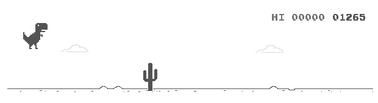
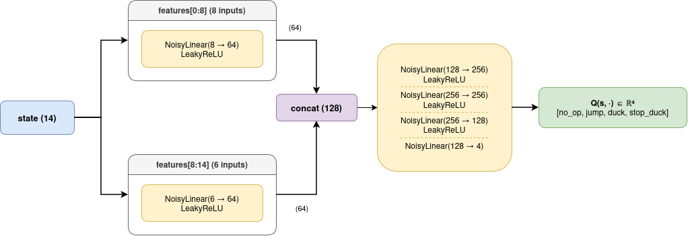

# Chrome Dino RL Agent — NoisyDQN

A Deep Neural Network agent that plays the classic Chrome Dino (T-Rex Runner) game in real time.  





---

## Network architecture

The model is a two-branch NoisyDQN. The 14-dimensional state vector is split into two parts: the 8 continuous game-state features and the 6 previous actions. Each branch is processed independently, then concatenated and passed through a shared MLP head that outputs 4 Q-values (one per action).




## Installation

```bash
git clone https://github.com/vvs0713/chrome_dino_RL_agent.git
cd chrome_dino_RL_agent
pip install -r requirements.txt
```
---
## Usage

```bash
python main.py --num_games 5 --game_time 120
```

### CLI arguments


|Flag | Type | Default | Description |
|-----|------|---------|-------------|
|-gt, --game_time|	float|	599.0|	Time limit per game (seconds)|
|-ng, --num_games|	int |	10|	Number of consecutive games to play
|-v, --verbose|	flag	|False|	Print state at every step


## Training techniques

The training loop combines five orthogonal tricks. Each one targets a different failure mode of vanilla DQN on a fast, real-time game:

| # | Technique | Where | Why it matters |
|---|-----------|-------|----------------|
| 1 | **NoisyNet exploration** | `net/net.py` (`NoisyLinear`) | Learned, per-parameter exploration instead of ε-greedy. Removes the need for an ε schedule and lets the network decide *where* to be uncertain. At eval time the noise is switched off (`model.eval()`), so test games are fully deterministic. |
| 2 | **Frame skipping = 5** | `train/one_game.py` (`if k == 5:`) | The agent acts once every 5 captured frames. This (a) matches the human reaction granularity in the game, (b) reduces redundant transitions caused by tiny frame-to-frame changes, and (c) makes the effective horizon shorter, which stabilises TD targets. |
| 3 | **N-step returns, `n = 10`** | `train/one_game.py` (`n_step = 10`) | Rewards are propagated 10 steps into the future before being written to the buffer. Combined with `gamma = 0.999`, this lets the agent credit the jump decision to the crash (or safe landing) that happens ~10 frames later, which pure 1-step TD struggles with in a sparse-reward game. |
| 4 | **Uniform action sampling** | `train/memory.py` (`ReplayBuffer.sample`) | When a batch is formed, transitions are sampled *evenly across the 4 action buffers* (`batch_size // 4` per action), with the remainder assigned to `no_op`. Without this, the buffer is ~95% `no_op` transitions and the network never sees enough jump/duck examples. |
| 5 | **Uniform time sampling** | `train/memory.py` (`GlobalReplayBuffer.sample`) | On top of action balancing, the global buffer is split into 4 game-time intervals (0–30s, 30–60s, 60–90s, 90–120s) and sampled evenly across them. This prevents catastrophic forgetting of early-game dynamics (slow obstacles) once the agent has mostly seen late-game, high-velocity frames. |

**How they compose.**  
A batch of size `B` is effectively `B/4` samples per time interval × `B/16` samples per (time, action) cell, each drawn via Prioritized Experience Replay inside its own SumTree. Priority updates are routed back through both `time_origin` and `action_origin`, so the SumTree priorities stay correct across the 16 sub-buffers.

## Training

The agent is trained from scratch using a custom Double DQN loop with NoisyNet exploration. Training is decoupled from inference: `train.py` runs episodes, fills the replay buffer, and periodically evaluates the greedy policy on clean (noise-free) test games.

#### Quick start

```bash
# Basic run: 1000 episodes, 100 gradient steps after each episode,
# target network sync every 10 episodes, test game every 10 episodes
python train.py -te 1000 -ts 100 -us 10 -t 10

```


---

## Limitations

Screen resolution and DPR

    DPR ≠ 1 breaks window positioning. driver.execute_script("return screen.width;") returns CSS pixels, while mss captures physical pixels. On HiDPI displays (macOS Retina, Windows 125%/150%/200% scaling, some Linux setups) the browser window ends up in a different physical position than the code assumes, and the crop drifts off the canvas.

    On a 4K screen this downscales by 0.5× and blurs thin obstacles, which degrades argmin / argmax-based distance detection. On a smaller screen it upscales and introduces interpolation artifacts.

OS and display server

    Tested only on Ubuntu with X11.

    options.add_argument("--ozone-platform=x11") is Linux-specific and assumes an X11 session.

    Wayland is not supported: pyautogui and Selenium's set_window_rect behave differently (or fail) under Wayland.

    Windows and macOS were not tested. They may work for the browser part, but pyautogui keyboard emulation and window positioning are platform-dependent, and the game-area coordinates will need re-tuning.

    Requires an interactive desktop session. pyautogui sends real keyboard events, so the script must run in a graphical session (or under xvfb-run on a headless server).

Browser

    Google Chrome only. The project targets chrome://dino, which exists only in Chromium-based browsers, and the game-over hook reads Runner.getInstance().crashed from the page's JS context — this requires the internal game object to be reachable (it is in stock Chrome, but may be disabled by flags or future updates).


---

## References

    Fortunato et al., Noisy Networks for Exploration, ICLR 2018. arXiv:1706.10295

    Mnih et al., Human-level control through deep reinforcement learning, Nature 2015.

    Chrome T-Rex Runner (built-in chrome://dino page).

---

## License

MIT — free to use for educational and personal purposes.


